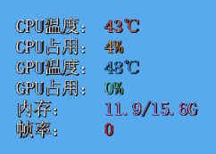
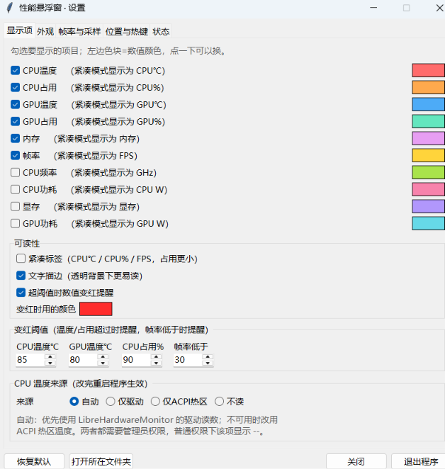
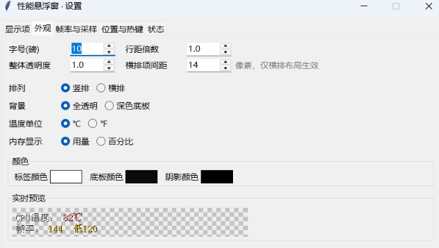

# 性能悬浮窗

面向游戏的实时性能叠加层：背景全透明，字号可以很小，按住文字即可拖动定位，显示哪几项自己勾选，
标签与数值分色显示（例如「CPU温度：`80℃`」两段颜色不同）。

窗口无底板、不抢焦点、支持鼠标点击穿透，不会遮挡操作。程序不联网、不写注册表、不安装服务或驱动、
不设置开机自启，退出后温度采集与帧率子进程立即全部释放，删除目录即为彻底卸载。

## 效果预览

默认六项、竖排、8 磅字号，桌面空闲时的实际显示：



## 下载与版本

| 版本 | 获取方式 | 说明 |
|---|---|---|
| 免安装 exe 版 | [Releases](https://github.com/9840333w/Performance-Testing/releases/latest) 中的 `perf-overlay-portable-v1.0.0.zip` | 解压双击 `性能悬浮窗.exe`，目标电脑无需安装 Python（压缩包约 14.8 MB，解压后约 36 MB） |
| 脚本版（本仓库内容） | [Releases](https://github.com/9840333w/Performance-Testing/releases/latest) 中的 `perf-overlay-script-v1.0.0.zip`，或直接下载仓库 ZIP、`git clone` | 需要 Python 3.10 及以上，便于阅读与修改源码 |

两个版本功能一致，配置互相独立，各自在自己的目录下生成 `config.json`。

## 快速开始

脚本版：

1. 双击 `安装依赖.bat`（首次使用执行一次，安装 psutil、pythonnet、pywin32、pillow）。
2. 双击 `启动.bat` 即可使用。
3. 需要 CPU 温度时改用 `启动(管理员).bat`，在 UAC 中选择「是」。

exe 版：双击 `性能悬浮窗.exe`，在 UAC 中选择「是」。提权要求已写入程序清单，每次启动都会请求管理员权限，
因为 CPU 温度需要读取 CPU 内部寄存器或 ACPI 热区，普通权限下系统拒绝访问。其余项目不需要管理员权限。

首次运行如果没有看到悬浮窗，检查系统托盘（Windows 11 上可能被收进通知区域的折叠菜单）。

## 显示项目

默认开启六项：CPU 温度、CPU 占用率、GPU 温度、GPU 占用率、内存、帧率。
另有 CPU 频率、CPU 功耗、显存、GPU 功耗四项，在设置 → 显示项中勾选。
取不到的项目一律显示 `--`，不影响其余项目。

## 操作

| 动作 | 方式 |
|---|---|
| 打开设置 | 右键悬浮窗任意位置；或托盘图标左键；或 `Ctrl+Alt+SHIFT+C` |
| 移动位置 | 按住悬浮窗上的文字拖动；或设置中的移动模式、四角锚点、X/Y 坐标 |
| 调整字号 | 鼠标滚轮；或 `Ctrl+Alt+=` / `Ctrl+Alt+-` |
| 显示项与颜色 | 设置 → 显示项（色块点一下换色） |
| 横排项目间距 | 设置 → 外观 → 横排项间距 |
| 显示 / 隐藏 | `Ctrl+Alt+H`；或托盘图标双击 |
| 鼠标点击穿透 | 设置 → 位置与热键；或 `Ctrl+Alt+SHIFT+P` |
| 退出 | 设置面板右下角「退出程序」；或托盘右键 → 退出 |

背景全透明用的是抠色（color key），Windows 只把绘制了内容的像素交给鼠标，空白处会穿透到下层窗口，
所以直接拖动需要按住文字本身。需要精确摆位时用设置里的「移动模式」——整块临时变成深色底板，随便拖，
再点一次存好位置回到全透明。位置每次都会写进 `config.json`。

设置面板共五页：显示项、外观、帧率与采样、位置与热键、状态。详细参数见 [使用说明.md](使用说明.md)。

<table>
<tr>
<td width="470"></td>
<td width="470"></td>
</tr>
<tr>
<td align="center">显示项：勾选项目、逐项数值颜色、紧凑标签、文字描边、超阈值变红、CPU 温度来源</td>
<td align="center">外观：字号、行距、横排项间距、透明度、排列方式、背景、温度单位、内存显示方式与实时预览</td>
</tr>
</table>

## 数据来源

| 项目 | 来源 | 权限 |
|---|---|---|
| CPU 占用率、内存 | psutil（系统接口） | 不需要 |
| GPU 温度、占用率、显存、功耗 | LibreHardwareMonitorLib，进程内调用厂商驱动接口 | 不需要 |
| CPU 温度 | LibreHardwareMonitorLib 驱动读数，不可用时改用 WMI 的 ACPI 热区温度 | 需要管理员 |
| 帧率 | Intel PresentMon 子进程，按 ETW 逐帧统计呈现事件 | 不需要 |

帧率按目标进程的实际呈现次数计算，窗口、无边框窗口与独占全屏都能统计；默认跟随前台窗口进程，
可改为跟随当前出帧最多的进程。画面静止时帧率为 0 属于正常情况。

部分平台在 Windows 11 下无法加载 ring0 硬件监测驱动，此时 CPU 温度自动改用 ACPI 热区数值。
热区温度与 CPU 封装温度不完全等价，通常略低、变化更平缓，适合作为趋势参考；
可在设置 → 显示项 → 「CPU 温度来源」中强制指定驱动 / 热区 / 关闭。

## 资源占用

以 i5-12500H + RTX 3050 实测：默认六项全开时约 1.4% CPU（其中帧率子进程 0.2%–1.0%），
关闭帧率项后约 0.5%；内存约 174–180 MB，主要来自承载硬件监测库的 .NET 运行时。
不占用 GPU 渲染资源，无网络请求，运行期间不写磁盘。

需要再低可以把 设置 → 帧率与采样 → 采样间隔 从 1000ms 调到 2000ms，并取消不看的显示项。

## 分发前需要知道的三件事

1. **首次运行**：程序没有做代码签名，双击 `性能悬浮窗.exe` 时 SmartScreen 可能提示「Windows 已保护你的电脑」，
   选择「更多信息 → 仍要运行」即可，只有第一次会弹。
2. **安全软件**：这是帧率项最常见的失败原因。硬件监测库加载、ETW 逐帧统计子进程、透明置顶窗口、全局热键
   这几个特征组合容易被误报，建议把整个目录加入白名单。帧率长期显示 `--` 时，先到安全软件的隔离区与拦截日志里
   确认 `vendor\presentmon\presentmon.exe` 有没有被处理掉，设置 → 状态 也会写明是启动失败还是目标未识别。
   程序本身不联网、不写注册表、不装服务、不设自启。
3. **反作弊**：带内核级反作弊的游戏对叠加层与 ETW 会话较敏感，建议先在游戏外运行一段时间确认无误，
   再决定是否在游戏内使用。

独占全屏下部分游戏会独占显示输出，此时任何叠加层都可能不显示，把游戏改成「无边框窗口（Borderless）」
最稳。

## 从源码打包 exe

在脚本版源码目录下执行（Windows 命令提示符）：

```
pyinstaller --noconfirm --clean --windowed --uac-admin --name 性能悬浮窗 --icon assets\app.ico --noupx ^
  --hidden-import win32timezone --exclude-module PIL --exclude-module numpy ^
  --exclude-module win32ui --exclude-module win32print --exclude-module win32inet ^
  --exclude-module win32clipboard --exclude-module win32trace --exclude-module tkinterdnd2 ^
  --exclude-module pygame --exclude-module aiohttp --exclude-module unittest ^
  --exclude-module setuptools --exclude-module pip perf_overlay.py
```

`vendor\` 与 `assets\` 作为外置文件与 exe 同级放置，不内嵌进单文件包，避免每次运行向临时目录解压。
注意事项见 [使用说明.md](使用说明.md) 的「构建」一节。

## 第三方组件

| 组件 | 用途 | 许可 |
|---|---|---|
| [LibreHardwareMonitor](https://github.com/LibreHardwareMonitor/LibreHardwareMonitor) | 温度 / 占用率 / 功耗采集 | MPL 2.0 |
| [Intel PresentMon](https://github.com/game-engine-resources/PresentMon) | 帧率逐帧统计 | MIT |
| [psutil](https://github.com/giampaolo/psutil) | CPU 占用率、内存 | BSD-3-Clause |
| [pythonnet](https://github.com/pythonnet/pythonnet) | 加载 .NET 监测库 | MIT |
| [pywin32](https://github.com/mhammond/pywin32) | 托盘图标、全局热键 | PSF |
| [Pillow](https://github.com/python-pillow/Pillow) | 托盘图标绘制 | MIT 类许可 |

## 环境要求

Windows 10 / 11 64 位。显卡 NVIDIA、AMD 或 Intel 核显均可，GPU 温度依赖厂商驱动接口。
脚本版另需 Python 3.10 及以上（安装时勾选 Add Python to PATH）。
