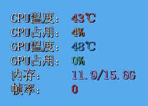
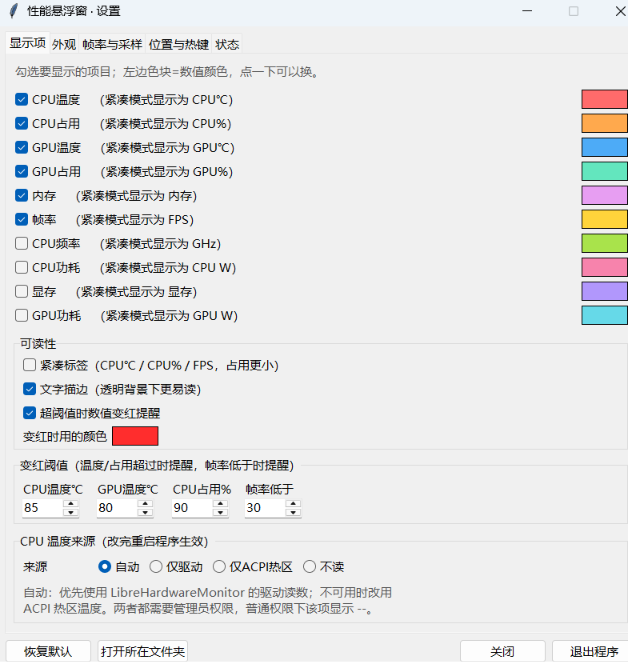
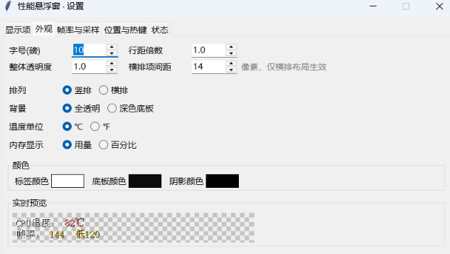

# 性能悬浮窗

面向游戏的实时性能叠加层：透明背景、小字号、可拖动定位、按需显示项目，不影响操作与画面。

- 显示项目：CPU 温度、CPU 占用率、GPU 温度、GPU 占用率、内存、帧率；另有 CPU 频率、CPU 功耗、显存、GPU 功耗四项可选
- 标签与数值分色显示，每项数值颜色可单独设置
- 无边框、置顶、不抢占焦点，支持鼠标点击穿透
- 不联网、不写注册表、不安装服务、不设置开机自启；退出即释放全部硬件访问

## 环境要求

| 项目 | 要求 |
|---|---|
| 操作系统 | Windows 10 / 11 64 位 |
| Python | 3.10 及以上（安装时勾选 Add Python to PATH） |
| Python 库 | psutil、pythonnet、pywin32（可选）、pillow（可选） |
| 显卡 | NVIDIA、AMD 或 Intel 核显；GPU 温度依赖厂商驱动接口 |

## 安装与启动

1. 首次使用双击 `安装依赖.bat`，安装所需的 Python 库。
2. 日常使用双击 `启动.bat`。
3. 需要 CPU 频率、CPU 功耗或驱动级 CPU 温度时双击 `启动(管理员).bat`，在 UAC 对话框中选择“是”。

CPU 温度的驱动级读数需要管理员权限（要读 CPU 内部寄存器）；热区计数器不需要，普通权限也能取到温度。
其余项目不受影响，未取到的项目以 `--` 显示。

## 界面操作

| 操作 | 方式 |
|---|---|
| 打开设置 | 右键悬浮窗任意位置；或托盘图标左键；或 `Ctrl+Alt+SHIFT+C` |
| 移动位置 | 按住悬浮窗上的文字拖动；或使用设置中的移动模式、四角锚点、X/Y 坐标 |
| 调整字号 | 鼠标滚轮；或 `Ctrl+Alt+=` / `Ctrl+Alt+-` |
| 显示项与颜色 | 设置 → 显示项 |
| 横排项目间距 | 设置 → 外观 → 横排项间距 |
| 显示 / 隐藏 | `Ctrl+Alt+H`；或托盘图标双击 |
| 点击穿透 | 设置 → 位置与热键；或 `Ctrl+Alt+SHIFT+P` |
| 退出 | 设置面板右下角“退出程序”；或托盘右键 → 退出 |

托盘图标：左键打开设置，右键弹出菜单，双击显示/隐藏。Windows 11 上可能被收纳在通知区域的折叠菜单中。

背景透明时，只有绘制了内容的像素接收鼠标事件，空白处会穿透到下层窗口，因此直接拖动需要按住文字。
需要精确摆位时使用设置中的移动模式（临时显示底板，可整块拖动）或四角锚点、坐标输入。
位置写入 `config.json`，下次启动保持原位。

桌面空闲时默认六项的实际显示（竖排、8 磅字号）：



## 设置面板

| 标签页 | 内容 |
|---|---|
| 显示项 | 十个项目的开关、每项数值颜色、紧凑标签、超阈值变红及其阈值与颜色、CPU 温度来源 |
| 外观 | 字号、行距、横排项间距、整体透明度、竖排/横排、全透明/深色底板、温度单位、内存显示方式、文字描边开关与标签/底板/阴影颜色，含实时预览 |
| 帧率与采样 | 帧率跟随目标、统计窗口、1% Low 显示、采样间隔 |
| 位置与热键 | 移动模式、四角锚点、X/Y 坐标、六个全局热键、置顶/穿透/热键开关 |
| 状态 | 权限、数据源、显卡、帧率目标进程、托盘与热键状态、配置与日志路径 |

「显示项」与「外观」两页：

<table>
<tr>
<td width="470"></td>
<td width="470"></td>
</tr>
</table>

超阈值变红默认值：CPU 温度 85℃、GPU 温度 80℃、CPU 占用率 90%、帧率低于 30，均可修改或关闭。

## 数据来源

| 项目 | 来源 | 权限 |
|---|---|---|
| CPU 占用率、内存 | psutil（系统接口） | 不需要 |
| GPU 温度、占用率、显存、功耗 | LibreHardwareMonitorLib（进程内调用厂商驱动接口） | 不需要 |
| CPU 温度 | LibreHardwareMonitorLib 驱动读数；不可用时改用 ACPI 热区温度（系统性能计数器） | 驱动读数需要管理员，热区不需要 |
| 帧率 | Intel PresentMon 子进程（ETW 逐帧统计 DXGI / D3D9 / D3D12 呈现事件） | 不需要 |

帧率以目标进程的实际呈现次数计算，覆盖窗口、无边框与独占全屏模式。默认跟随前台窗口进程，
可改为跟随当前出帧最多的进程。画面静止时帧率为 0 属于正常情况。

热区读数优先走系统性能计数器（win32pdh），普通权限即可读取；没有该计数器的系统自动回退到 WMI 的
ACPI 热区（需要管理员权限）。热区温度与 CPU 封装温度不完全等价，通常略低且变化更平缓，适合作为趋势参考。
任何一次读取失败都会立即显示 `--`，不会继续显示上一次的历史数值。
可在设置中强制指定来源或关闭该项。

数据源的健壮性按下面三条保证：任何一路硬件调用都放在独立线程里，主循环只取上一次成功的结果，
所以某一路变慢或挂住不会拖累其他项目；某一路本轮刷新失败就不读它的值（库内部有缓存，直接读会得到一个
不再变化的历史数字）；本该随负载变化的量如果长时间一动不动，会被判定为数据源未刷新，改显示 `--`，
直到它重新变化才恢复。具体是哪一路出了问题，设置 → 状态 会写明每个硬件的采集状态。

## 文字与可读性

文字统一使用宋体，小字号为点阵渲染，可读性最好；系统中不存在宋体时按 SimSun、NSimSun、
微软雅黑顺序回退。

透明背景采用 color key 抠色。抗锯齿文字的边像素是字色与键色的混合值，只有与键色完全相同的
像素会被抠掉，因此键色取近黑色：混合结果表现为文字自身的暗色描边，在各种画面上都清晰。
界面取色若与该键色过于接近会被自动调整，避免文字被当成背景抠除。

文字描边是在笔画外垫 1px 暗边，默认开启，亮画面上更易读；大字号走抗锯齿时它会显得笔画发糊，可以在 设置 → 外观 → 颜色 取消勾选「文字描边」，取消后阴影颜色同时停用、不可点。

行高为字高加上按字号比例的最小间隙，项目之间不会相互贴字。

字号影响清晰度是宋体自身的渲染特性：它的内置点阵只覆盖一小段像素尺寸，125% 缩放下实测 7–10 磅
落在点阵上（8–10 磅笔画边缘没有半过渡像素，最锐利），6 磅及以下、11 磅及以上切换到轮廓加灰度抗锯齿，
边缘变成半透明过渡，看起来偏软。建议字号取 7–10 磅；发糊时先缩小字号，再考虑关闭文字描边
（描边只在抗锯齿区间会加重柔和感，点阵区间不受影响）。这不是取色、描边或透明背景导致的故障。

## 配置文件

所有设置保存在同目录 `config.json` 中，删除该文件即恢复默认。主要字段：

```jsonc
{
  "font_size": 8,                  // 字号（磅），6–18
  "line_spacing": 1.0,             // 竖排行距倍数
  "hgap": 14,                      // 横排时项目之间的像素间距
  "label_color": "#ffffff",        // 标签颜色
  "colors": { "cpu_temp": "#ff6b6b" },   // 每项数值颜色
  "separator": "：",
  "compact_labels": false,         // 紧凑标签（CPU℃ / CPU% / FPS）
  "text_shadow": true,             // 文字描边（设置 → 外观 可关）
  "layout": "vertical",            // vertical / horizontal
  "bg_mode": "transparent",        // transparent / panel
  "opacity": 1.0,                  // 整体透明度 0.3–1.0
  "interval_ms": 1000,             // 采样间隔
  "temp_unit": "c",                // c / f
  "mem_mode": "gb",                // gb / percent
  "cpu_temp_source": "auto",       // auto / lhm / acpi / off
  "fps_follow": "foreground",      // foreground / busiest
  "fps_window_ms": 1500,           // 帧率统计窗口
  "fps_show_low": false,           // 显示 1% Low
  "warn_enabled": true,
  "thresholds": { "cpu_temp": 85, "gpu_temp": 80, "cpu_load": 90, "fps": 30 },
  "click_through": false, "always_on_top": true, "hotkeys_enabled": true,
  "hotkeys": { "toggle_visible": "CTRL+ALT+H" },   // 修改后重启生效
  "enabled": { "cpu_temp": true },                 // 各显示项开关
  "position": [38, 21]                             // 窗口位置
}
```

## 常见问题

**首次运行被系统提示** — 程序未做代码签名，SmartScreen 弹出「Windows 已保护你的电脑」时选择
「更多信息 → 仍要运行」，只有第一次会弹。若提示的是「Windows 无法访问…你可能没有适当的权限」，
说明该文件带有来自 Internet 的下载标记并被锁定，在压缩包或该文件上右键 → 属性 → 勾选「解除锁定」
后重新解压。本地打包或直接克隆仓库得到的文件一般不会有这种提示。

**某一项一直是 `--`** — 看设置 → 状态：那里会写明每个硬件的采集状态（正常 / 更新失败 / 采集无响应）。
某个数值长时间一动不动也会被主动显示成 `--`，因为那说明数据源没有刷新，继续显示一个不变的数字更误导。同一时刻 `运行日志.txt` 会记一行「数据源异常」，附上各硬件的刷新结果，把这一行发给作者就能直接定位是哪一路取不到值。

**CPU 温度显示 `--`** — 普通权限下走热区计数器，一般都有值。显示 `--` 说明热区没有返回有效读数：可能是 BIOS 未暴露热区、系统缺少 Thermal Zone 计数器，或该次读取失败（失败时不会沿用旧值）。需要驱动级封装温度时用 `启动(管理员).bat`。

**帧率显示 `--` 或 0** — 查看设置 → 状态：提示 presentmon 启动失败时，检查
`vendor\presentmon\presentmon.exe` 是否被安全软件拦截（这是该项最常见的失败原因，安全软件的
隔离区与拦截日志里可以直接确认）；提示目标未识别时，将“帧率跟随”改为
“出帧最多的进程”。画面静止时显示 0 为正常情况。

**悬浮窗被其他窗口挡住** — 程序每 2 秒检查一次 z 序，发现被普通窗口压住会自动重申置顶，正常情况
下两秒内就回到最前。若长时间仍被挡住：确认「设置 → 位置与热键 → 窗口置顶」处于勾选状态（取消再勾上
可立即重申）；独占全屏的游戏会独占显示输出，任何叠加层都无法显示，需要把游戏改成无边框窗口。

**全屏游戏中看不到悬浮窗** — 独占全屏时部分游戏会独占显示输出，改为无边框窗口模式可稳定显示。

**热键无响应** — 设置 → 状态会列出与其他程序冲突的热键，可在“位置与热键”中改为未占用的组合，
修改后重启程序生效。也可通过托盘图标操作。

**帧率组件无法启动** — 若程序曾被强制结束，可能遗留 ETW 会话。程序启动时会自动清理自身遗留的
会话与子进程；也可在管理员命令行中执行 `logman query -ets` 查看、`logman stop <会话名> -ets` 清除。

**资源占用** — 约 1% CPU（关闭帧率项时约 0.5%）、约 180MB 内存。内存主要来自 .NET 运行时。

## 卸载

关闭程序后删除整个目录即可。程序不写入注册表，不安装服务、驱动或计划任务，不设置开机自启。
`config.json`、`运行日志.txt`、`assets/` 均为运行期间生成。

## 目录结构

```
perf_overlay.pyw        主程序：悬浮窗、设置面板、全局热键
sensors.py              温度、占用率、内存采集
fpsmon.py               帧率采集与 PresentMon 子进程管理
tray.py                 系统托盘图标
启动.bat                普通权限启动
启动(管理员).bat         管理员权限启动（CPU 频率 / 功耗与驱动级温度）
安装依赖.bat             安装 Python 依赖
requirements.txt         依赖清单
config.json              运行配置（自动生成）
运行日志.txt             启动信息与异常记录
vendor/lhm/              LibreHardwareMonitor 的 .NET 库（进程内调用，不安装）
vendor/presentmon/       Intel PresentMon 命令行版（子进程调用，MIT 许可）
assets/tray.ico          托盘图标
README.md                项目首页说明
LICENSE                  MIT 许可
THIRD-PARTY-NOTICES.md   第三方组件许可清单
docs/                    预览图与设置面板截图
```

## 许可

源代码采用 MIT 许可，见 `LICENSE`。`vendor/` 下的第三方二进制组件保持各自原许可
（LibreHardwareMonitorLib 为 MPL-2.0，HidSharp 为 Apache-2.0，PresentMon 为 MIT），
清单与上游地址见 `THIRD-PARTY-NOTICES.md`。
